<!-- ======= HERO SECTION ================== -->

<h1 align="center">
  
  Hello, I'm <strong>Arfa Munam | 아르파 무남</strong> 👋
</h1>

  

  

 

<h1>⚡ MY // DEVELOPER PROFILE</h1>

<samp>┌─ SESSION: ACTIVE ───────────────────── SYSTEM: ONLINE ─┐</samp>

<table>
<tr>
<td width="48%" align="center" valign="top">

<h3>01 / IDENTITY</h3>


<samp>BUILD · CODE · CREATE · IMPACT</samp>

</td>
<td width="52%" valign="top">

<h3>02 / SYSTEM INFO</h3>

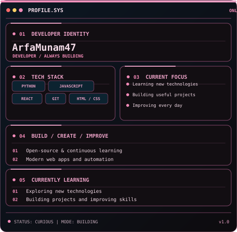

</td>
</tr>
</table>

<samp>_ Thanks for visiting my profile! &nbsp; // &nbsp; Small Steps → Big Dreams _</samp>

  

## 📬 Get In Touch

&nbsp;

 

  

<!-- ═════════════════════ ABOUT / CREATIVE STUDIO ═════════════════════ -->

<h2>01 &nbsp; / &nbsp; INSIDE MY WORLD 🪄</h2>

<h3>Curious mind. Creative instincts. Endless possibilities.</h3>

Not just what I build, but what makes me love building it.
 

 

  💻 I'm a <strong>Computer Science student and frontend developer</strong> who loves transforming ideas into experiences people can actually interact with.

  🎨 Somewhere between design, code and artificial intelligence, I found my playground. I enjoy experimenting with new technologies, exploring creative workflows and turning curious ideas into something real.

 

<table width="100%">
<tr>
<td width="50%" align="center" valign="top">

<h3>01 / DESIGN & INTERFACES</h3>

  

Creative interfaces, thoughtful layouts, interactions and modern web experiences.

</td>
<td width="50%" align="center" valign="top">

<h3>02 / ARTIFICIAL INTELLIGENCE</h3>

  

Exploring AI tools, prompt engineering, intelligent workflows and automation.

</td>
</tr>
<tr>
<td width="50%" align="center" valign="top">

<h3>03 / CREATIVE CODING</h3>

  

Experimenting with ideas, creative development, motion and interactive experiences.

</td>
<td width="50%" align="center" valign="top">

<h3>04 / PROGRAMMING</h3>

  

Learning programming fundamentals and exploring Python for future automation projects.

</td>
</tr>
</table>

  <em>"Learn something. Build something. Make it better.🎀"</em>

  

<!-- ═════════════════════ THE HUMAN SIDE ═════════════════════ -->

<h2>02. THE HUMAN SIDE ❤️</h2>
BEYOND THE SCREEN · A LITTLE ABOUT ME

  

 &nbsp; 🎓 <strong>BS Computer Science</strong>
 
University of the Punjab
 

 &nbsp; ⌨️ <strong>80+ WPM</strong>
 
Fast typist · Ideas move fast, too.

 

 &nbsp; 📚 <strong>Books · People · Stories</strong>
 
Curious about perspectives, stories, and new things to learn.

 

 &nbsp; 🛠️ <strong>MAKE. BREAK. LEARN. REPEAT.</strong>
 
Always experimenting. Always improving.

 

  

<!-- ═════════════════════════════════════════════════════════ -->

<!-- ==================== LEARNING JOURNEY ==================== -->

## 03 — THE LEARNING JOURNEY

EVERY NEW SKILL STARTS WITH A FIRST STEP.

<table width="100%">
<tr>
<td width="18%" align="center" valign="top">

<h2>2025</h2>

</td>
<td valign="top">

### Frontend Development

Started building my foundation in web development and explored how ideas become interactive digital experiences.

`HTML` `CSS` `JavaScript` `Bootstrap`

</td>
</tr>
<tr>
<td width="18%" align="center" valign="top">

<h2>2026</h2>

</td>
<td valign="top">

### AI & Creative Development

Expanded my interests into prompt engineering, AI tools, vibe coding, and creative product development.

`React` `Prompt Engineering` `AI Tools` `Vibe Coding`

</td>
</tr>
<tr>
<td width="18%" align="center" valign="top">

<h2>NOW</h2>

</td>
<td valign="top">

### Exploring What's Next

Learning Python, exploring backend engineering concepts, and developing a deeper understanding of AI automation.

`Python` `Backend Fundamentals` `AI Automation`

</td>
</tr>
</table>

  

# Tech Stack 👌

  

  

## 🤖💡 THE DIGITAL EXPERIMENT LAB

<!-- ==================== DIGITAL EXPERIMENT LAB ==================== -->

MY CREATIVE WORKSPACE FOR EXPLORING IDEAS AND BUILDING PRODUCTS.

  

### AI ASSISTANTS & DEVELOPMENT

  

### CREATIVE BUILDERS & DEPLOYMENT

  

 

&nbsp; ⟶ &nbsp;

&nbsp; ⟶ &nbsp;

&nbsp; ⟶ &nbsp;

&nbsp; ⟶ &nbsp;

 

`01` **THINK**　`02` **BUILD**　`03` **EXPERIMENT**　`04` **REFINE**　`05` **SHIP**

 

 Curiosity → Creation → Iteration → Something Real 🎀

  

## 🌱 Currently Exploring

<table align="center" width="90%">
<tr>
<td width="62%" valign="middle">

⚙️ <strong>Backend Engineering</strong> 
Building reliable APIs and server side systems.

✨ <strong>Vibe Coding</strong> 
Turning ideas into polished products with AI powered workflows.

🤖 <strong>AI Automation</strong> 
Connecting AI, APIs, and intelligent workflows to build smarter applications.

 
</td>

<td width="40%" align="center" valign="middle">

</td>

</tr>
</table>

 

  

<!-- ==================== 🔥 GITHUB STREAK ==================== -->

## 🔥GitHub Streak

<table>
<tr>
<td style="border: 1px solid #6B3A4A; border-radius: 18px; padding: 8px; background-color: #17151A;">

</td>
</tr>
</table>

  

## ⌘ GitHub Journey

  

  

 ## ⚡ GitHub Statistics

  
  &nbsp;&nbsp;&nbsp;
  

  

 ## 💻 Languages

  
  &nbsp;&nbsp;&nbsp;
  

  

 ## ✨ Contribution Activity

  

  

  

## 👀🩷 Featured Projects

<i>A little collection of things I've designed and built ♡</i>

<table width="100%">
  <tr>
    <td width="50%" align="center" valign="top">
      <h3>🎀 PASTEL &amp; FORM</h3>
      <a href="YOUR_PASTEL_FORM_PROJECT_LINK">
        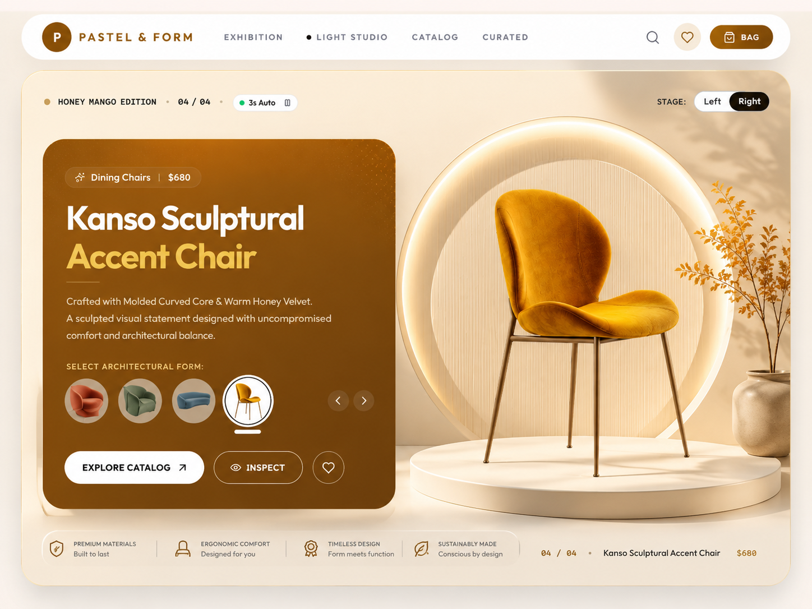
      </a>
      
✧ Soft aesthetics · Modern design

    </td>
    <td width="50%" align="center" valign="top">
      <h3>🍜 Kumo Ramen</h3>
      <a href="YOUR_KUMO_RAMEN_PROJECT_LINK">
        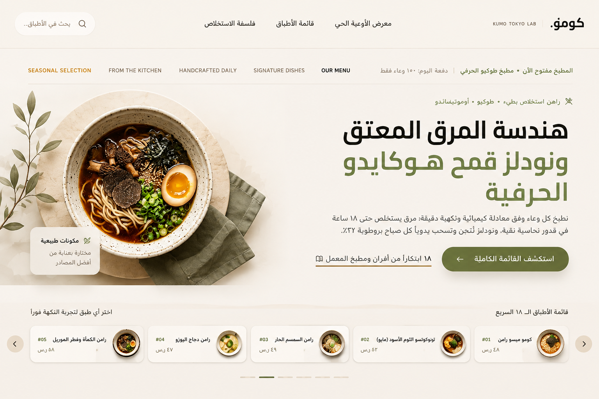
      </a>
      
✧ Food · Creative web experience

    </td>
  </tr>
  <tr>
    <td width="50%" align="center" valign="top">
      <h3>💭 Icapital</h3>
      <a href="YOUR_WOW_FUN_PROJECT_LINK">
        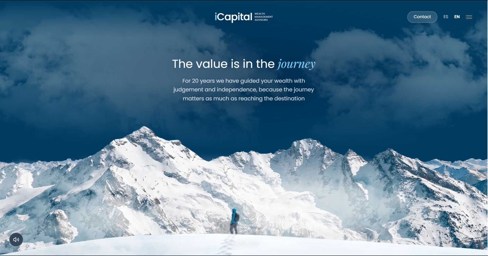
      </a>
      
✧ Playful visuals · Bold ideas

    </td>
    <td width="50%" align="center" valign="top">
      <h3>💕 Veloura Store</h3>
      <a href="YOUR VELOURA_STORE_PROJECT_LINK">
        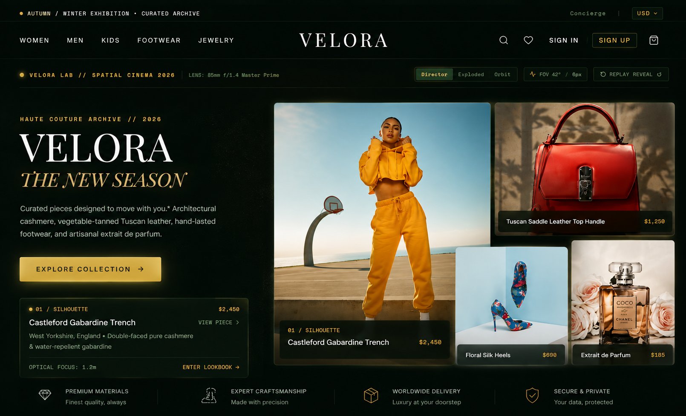
      </a>
      
✧ E-commerce · Elegant style

    </td>
  </tr>
</table>

<i>୨୧ Designed with creativity, built with curiosity, and always evolving. ♡</i>

  

## 👌🎀 THE ACTIVITY TRAIL

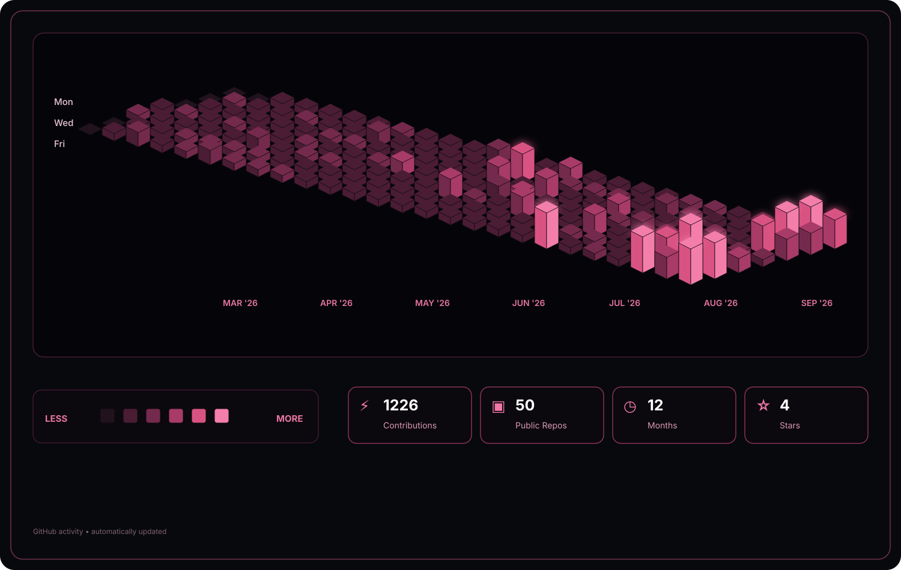

  

## 🐍 Contribution Snake Animation

  

 

## 🎀 THE WAY I BUILD

### 💭 → ✦ **FROM A THOUGHT TO SOMETHING REAL...** 🚀🎈

 

💭 A thought becomes a sketch.
✦ A sketch becomes an interface.
⚡ An interface becomes a product.

And somewhere between **curiosity and obsession,**
I keep refining until it **feels right.**

 

`◌ IMAGINE`  `✦ EXPLORE`  `◈ CREATE`  `⌁ REFINE`  `🚀 RELEASE`

 

Building ideas into experiences, one detail at a time.

 

> **“Leave no good idea unfinished.”**

  

## 📈 Contribution Overview

  

<h3>🤝 LET'S CREATE SOMETHING MEANINGFUL</h3>

  

<h3><i>"I don't just want to use technology. I want to create with it."</i></h3>
Feel free to explore my repositories, share feedback, or connect with me on my journey as a developer.

  

### 💗 `echo "Until next time..."`

<i>♡ Made with a little pink magic and lots of curiosity.</i>

<b>୨୧ ── Stay soft. Think boldly. Build beautifully. ── ୨୧</b>

Thanks for stopping by my little corner of the internet. 💗

  

